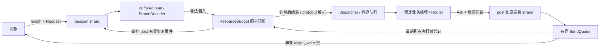

# 架构与阅读指南（截至 M2.4）

当前实现 TCP、可暂停输入、有界业务线程、本地/全局背压、每连接限流及心跳/期限。优雅 drain 和其他传输协议见 ROADMAP；没有持久化、自动重试或去重。

## 模块和消息流

- FrameDecoder 每次最多产出一帧，返回消费量及 NeedMore/FrameReady/AwaitingCapacity/Error。完整帧保留到 take_body；完整合法包头取得准入许可后才 reserve 消息体。
- BufferedInput 保存固定 4 KiB 读块、未消费偏移和解码器。暂停可保留包头、完整帧和原始尾部；恢复先处理这些数据，再发起新读。即使只剩包头且原始输入为空，也会重试准入。
- Session 独占网络对象、输入和发送队列，负责资源准入、protobuf 解析和任务投递。Request 自己拥有数据，不把 body 引用交给 worker。
- ResourceBudget 用短 mutex 临界区统一检查和更新本地/全局额度，返回可移动、不可复制的 ResourceLease。通知只在锁外发起，网络操作始终回到 strand。
- Router 仅依赖 Request/Ack 和原子 Statistics。Dispatcher 用固定 jthread 和显式 BoundedTaskQueue；Handler、完成回调、资源释放通知均在队列锁外执行。
- Config 校验硬限额、水位和静态读池的关系；Server 管理连接、信号和线程生命周期。

## 线程关系与串行性

一个 io_context 由 io_threads 个线程运行，包含主线程；business_threads 是额外的业务线程。strand 保证同连接回调不并发，不保证固定 OS 线程。Server 的 acceptor、signal_set 和连接表属于管理 strand；每个 socket 使用独立 strand。

每连接最多一个业务任务处于排队、执行或等待结果的状态；Accepted 后暂停新业务及新读。结果回到 strand 后排队 ACK，销毁 ACK 对象并释放旧业务凭证，再恢复已有输入。这保持同连接处理和 ACK 顺序，不需要结果重排缓存，不同连接可并行。

read_in_progress_ 防止解析器访问在途读正在写的缓冲。写链由首次入队及上次写完成驱动，最多一条 async_write。暂停不取消已发起的读，其返回数据已由固定读块覆盖。服务端暂停期间可能暂时检测不到对端 EOF；恢复读或 ACK 写入时再处理。

## 先预留，再分配

长度 L 通过协议及单连接接收校验后，try_frame 在同一锁下检查全部硬限额和水位，原子取得以下三个凭证；失败不保留部分新凭证：

| 凭证 | 数量 | 字节 | 生命周期 |
| --- | --- | --- | --- |
| Receive | 1 | L | 组装消息体，直到 BufferedInput 销毁 body 存储 |
| Business | 1 | L + 16 + 256 | 待投递 Request、任务执行、完成结果 |
| Send | 1 | 256 | ACK 输出预留，直到线帧最后一个所有者释放 |

Request 解析后的 ByteSizeLong 可能比收到的编码大，例如 enum 的非规范负数编码；16 字节余量覆盖当前消息结构的规范化扩展。解析后 Business 缩为实际 Request 字节数 + 256。worker 生成 ACK 时 Request 尚在，因此两者并存需要这段额外空间；Request 销毁后才把 Business 缩为 256。

ACK protobuf 消息体最多 252 字节、含头线帧最多 256 字节。worker 先补原 request_id，再校验 Handler 输出；超大输出销毁后改为固定 INTERNAL_ERROR，避免无限错误文本进入完成队列。Handler 内部任意临时分配不由网关控制，新增 Handler 仍应限制自己的分配。

strand 直接把 ACK 序列化到一份已预留的线帧中，避免 SerializeAsString 再复制。Send 缩为实际线帧大小。ACK 对象销毁后归还 Business，线帧继续持有 Send；接收原文与解析对象同时存在时分别计费。

每连接在创建 Session 前还取得整个 4096 字节 Read 凭证，消息数记 0。`global_budget_bytes` 按 `max_connections * 4096` 划出固定读池；剩余供动态三阶段使用。构造时要求动态池至少 530 字节、总消息额度至少 3。不会启动时分配所有读块，统计只计实际持有量。静态池不参与动态水位，否则闲置连接可能使动态工作永久停读。

统一消息数量是各阶段凭证之和，一帧初始占 3；统一字节包含实际 Read 凭证和动态预留。数量限制也约束相关对象数，但序列化字节不是精确 RSS：对象、容器、分配器开销未逐字节计量。

## 队列和统一预算的区别

| 限制 | 字节成本 | 归还时机 |
| --- | --- | --- |
| queued | Request::ByteSizeLong() | worker 取走或 stop 丢弃 |
| outstanding | Request::ByteSizeLong() | strand 消费/丢弃结果，TaskTicket 释放 |
| 统一 Business | 初始 L+16+256，随后逐阶段缩减 | BusinessResult 消费/丢弃 |

统一 Business 消息上限等于 outstanding_messages，字节上限为 outstanding_bytes 加 outstanding_messages*(16+256)。待投递但尚未被队列接受的 Request 也占统一 Business。TaskTicket 持有已接受任务的队列额度和统一凭证，跟随结果回送；不能在 worker 刚取走任务时就把所有额度归还。

try_submit 只进入短临界区，不等空位；Accepted 才移动 Request 和资源，Full 保留调用者所有权。单个请求超过队列硬字节上限时直接关闭；临时 Full 则保留完整帧与已解析 Request，等待队列释放通知，不重复解析。

## 高低水位与恢复

相关本地/全局 Receive、Business、Send、动态总预算以及 queued 均检查数量和字节。高水位为 ceil(硬上限*high/100)，任一指标到达即锁存暂停；两项都 <= floor(硬上限*low/100) 才解除，且下一次完整申请仍须符合硬上限。默认 high=80、low=50。

水位控制新帧准入和新读。已获得整帧及下游额度的半帧允许继续读取，不能被自己的占用卡住。只读完包头、尚未获得许可时返回 AwaitingCapacity，保留偏移而不分配消息体。所有新读仍持有整块固定读信用，覆盖其他连接升水位时已发起 read 可能返回的数据。

等待登记最多每连接一项，每连接最多一个尚未执行完的 WakeupTicket。按登记顺序优先让可推进等待者申请，跳过因本地慢写仍不可推进的连接；释放方不能反复抢占已有合格等待者。通知在锁外 post 到原 strand，凭证析构推进下一位，避免广播产生无界回调。

资源释放与队列释放使用独立事件代次。预算检查与等待登记同锁；队列则先记录 epoch、try_submit，Full 后用旧 epoch 登记。如果两步之间已释放空间，代次差会触发恢复；若无新事件则不重复唤醒。唤醒不是准入承诺，strand 仍重新检查硬限额，先处理已有数据再考虑新读。

单帧即使独占资源仍放不下时返回 Impossible 并关闭；临时耗尽返回 Waiting。不能对永久无法满足的申请无限等待。

## 生命周期、取消与停止

数据先销毁，凭证后归还：成员先声明凭证、后声明数据，利用逆序析构；跨阶段所有权用 move 转移。OutgoingFrame 同时持有字节和 Send 凭证，队列和异步写回调共享同一个对象，只计费一次。close 清空队列后，在途写仍持有它，直到操作完成或取消回调结束才归还。

close 幂等，停止输入、移除等待登记、取消/关闭 socket，并向管理 strand 投递连接删除。Read 凭证跟 Session 存活到读回调结束；旧连接取消尚未完成时不能把读块槽位过早复用。后台任务持有自己的凭证，不因 Session 提前关闭而释放。

Session::make_completion 只捕获 weak_ptr、executor 和 work guard。worker 不访问 Session；结果 post 到原 strand，连接已关闭则丢弃。guard 保证最后一个 socket 关闭后仍执行迟到回送，result 析构归还预算。ResourceBudgetState 使用共享所有权活到最后一个凭证销毁；锁外执行通知，避免队列/预算锁嵌套和锁内网络发送。

当前 SIGINT/SIGTERM 仍立即停止监听、关闭连接、丢弃未执行任务；正在执行的业务完成后丢弃结果。I/O 不 join worker，run 返回后主线程统一 join，退出统计中的业务、预算、等待和唤醒计数应为零。没有 ACK drain，Handler 必须有限时返回。

M2.4 已对连接添加下述期限；连接关闭不代表后台 Handler 已结束，执行中业务仍必须有限时返回。M2.5 再实现 graceful drain。

## M2.4：限流和时间的两条轴

ConnectionPolicy 不持 socket，不自行读取时钟；调用方显式传 steady_clock 时间点，所有状态只在连接 strand 内访问。这样可以用任意精确时间点验证边界，不依赖测试 sleep。

每连接的消息令牌和消息体字节令牌必须一起满足。桶初始填满，0 补充速率禁用对应维度；合法包头到齐后先 peek，不扣费；全局帧预算成功后才一起扣费，后续半帧、队列 Full 或重复唤醒都不再扣同一帧。单帧超过启用的字节 burst 属于永久失败；暂时缺额由 timer 恢复，不循环重试。限流按连接，不是按设备或全局 QPS；全局容量仍由 M2.3 预算控制。

TokenBucket 用 1e9 个定点单位表示一个令牌，补充量为纳秒数乘每秒速率，保留小数信用。先比较填满需要多久，再进行乘法，避免长时间闲置导致溢出；等待时间向上取整到纳秒，避免不足一个单位时反复立即唤醒。

| 期限 | 计时起点/续期规则 | 是否扣除服务端暂停 |
| --- | --- | --- |
| idle | 建连起，随后只有完整、业务合法的遥测或心跳刷新；使用该帧最后读块的到达时间 | 否 |
| frame | 当前帧首字节的读块到达时间；后续零散字节不重置 | 是 |
| wait | 一次限流或容量等待开始；重复唤醒、Rate/Resource 切换不重置 | 否 |
| write | 当前 ACK 的 async_write 启动；覆盖整条写链，不按部分进度重置 | 否 |

BufferedInput 的 Observer 只报告 Started/Completed 各一次；Session 给每个读块记录原始墙钟时间及扣除暂停后的 peer 时间。完整原始尾部与半帧在后续业务结束后继续解析时，仍使用旧读块时间。这里的到达是应用执行 read 完成回调所观察到的时刻，不是内核收包或设备产生时间。Observer 是同对象内同步借用 this 的成员回调，Session 禁止复制/移动，不产生共享所有权环。

Accepted 业务、预算/队列或限流等待暂停新读取，frame 的 peer 时间冻结；恢复后继续累计剩余期限。idle 始终是“多久没有收到合法完整请求”的墙钟约束，因此长业务也可能触发 idle 并关闭连接；需按业务时长配置，不能将连接超时解释为业务未执行。关闭的 Session 不接收迟到结果，TaskTicket 仍归还预算。

## 单个定时器与恢复

一个连接只用一个 steady_timer，选择策略中最早的期限或令牌补充时刻。新的期限更晚时保留旧 timer，到旧时刻再检查策略并重新排期，减少每条消息的 cancel/rearm。需要提前唤醒、禁用或关闭时递增 generation 并取消旧操作；回调检查 closed、generation、operation_aborted 后才能继续。

handle_timer 从当前状态重新判断是否超时，不把旧 timer 的到期当作当前期限已到。仅令牌补充事件调用 resume_reading；容量等待依旧由 M2.3 通知唤醒。资源等待切换成本地限流等待时先撤销全局等待，防止其占住公平队首。

超时同时命中时固定按 write、wait、frame、idle 的优先级记录 reason。close 幂等并取消 timer；回调只弱引用 Session，读写操作继续强引用自己的缓冲所有者，取消后存储与预算仍活到相关回调结束。定时器和 I/O 都受调度影响，毫秒配置不是硬实时保证。async_write 完成不证明设备应用已收到 ACK，write 期限控制的是本机挂起写操作。

## 成功日志的开销控制

TCP 日志实验后，成功的 business_result 明细降为 debug，并在构造 JSON 之前检查 spdlog::should_log；默认 info 不构造或输出成功明细。失败结果、生命周期及汇总仍为 info，log_level=debug 可恢复逐请求诊断。日志仍同步执行，没有引入另一条无界异步日志队列；开启明细的成本见 docs/performance/tcp-logging-20261103.md。

## 优先阅读三个函数

1. ResourceBudget::try_frame（src/resource_budget.cpp）：一次取得三个资源凭证，失败时登记可恢复等待。
2. ResourceLease::release（同文件）：计数归还、低水位更新和锁外通知。
3. Session::process_buffered_input（src/server.cpp）：把准入、完整帧投递和接收额度释放接到解析器，恢复后先处理旧输入。

结合 ResourceBudgetState::candidate、WakeupTicket::finish 理解等待顺序和唤醒去重；结合 Dispatcher::run_worker、Session::handle_business_result 理解业务与发送预算交接。
