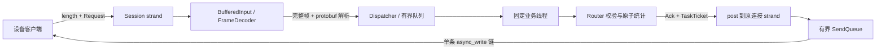

# 架构与阅读指南（M1 + M2.1 + M2.2）

当前实现 TCP、可暂停输入状态、有界业务执行与连接 strand 结果回送。全局收发预算、高低水位、超时、优雅 drain 和其他传输协议仍见 ROADMAP；没有持久化、自动重试或去重。

## 模块和消息流

- FrameDecoder 每次最多产出一帧，返回消费量和 NeedMore/FrameReady/Error；完整帧保留到 take_body。
- BufferedInput 是 Session 持有的输入状态，保存 4 KiB 固定读块、未消费偏移和解码器。消费者返回 Paused 时保留完整帧和原始尾部。
- Session 负责 socket 生命周期、protobuf 解析、任务准入和 ACK 编码。解析后的 Request 自己拥有数据，不把 body 引用交给 worker。
- Router 只依赖 Request/Ack 和 Statistics；校验公共字段后按 message_type 处理。统计使用原子自增，支持多个 worker 同时调用。
- Dispatcher 管理固定数量的 jthread，通过 BoundedTaskQueue 接受任务。Handler 和完成回调均在队列锁外执行，业务核心不包含 Asio 或 socket 类型。
- Config 校验配置类型/范围；Server 管理连接表、信号和业务线程生命周期。

M1 的同步 Dispatcher 接口已经移除。同步业务单测直接验证 Router；异步投递使用 dispatcher.hpp 中的 try_submit。

## 线程关系和串行性

一个 io_context 由 io_threads 个线程运行，包括主线程；business_threads 是额外的业务线程。strand 保证同连接回调不并发，不保证固定运行于某个 OS 线程。

Server 的 acceptor、signal_set、连接表属于管理 strand；每个 socket 使用独立连接 strand。BufferedInput、业务在途标志、读写链和发送队列都只在连接 strand 操作。

每连接最多有一个业务任务处于排队、执行或等待完成回送的状态。任务 Accepted 后暂停读取，BufferedInput 可保留下一完整帧和原始尾部；工作线程返回结果后，strand 先排队 ACK、归还旧任务凭证，再恢复已有输入。这保持同连接的处理/ACK 顺序，不需要结果重排缓存；不同连接可并行业务处理。

read_in_progress_ 防止读缓冲被在途操作和解析器同时使用。只在旧输入处理完、没有待接管完整帧、业务不在途且未暂停时启动新读。写链仍由首次入队和上一写完成回调驱动，不能重叠启动多个 async_write。

## 排队预算与总在途预算

业务容量有两层，均同时限制消息数和字节数：

| 层次 | 覆盖范围 | 归还时机 |
| --- | --- | --- |
| queued | 等待 worker 取走的任务 | wait_pop 取走，或 stop 丢弃 |
| outstanding | 排队 + 执行 + 尚未消费/丢弃的完成结果 | TaskTicket 释放 |

字节成本是 Request::ByteSizeLong()，不含 TCP 包头。它衡量序列化请求数据，不是精确 RSS。容器节点、protobuf 对象、回调和 ACK 还存在开销；任务数量上限同时限制这些对象的个数。生产 Router 只返回固定、较短的错误信息；任意新增 Handler 必须自行限制输出，M2.3 再加入输出空间预留。

仅限制排队任务是不够的：worker 可能很快取走任务并持续 post 结果，使 io_context 积累结果。TaskTicket 因此从排队任务移动到 BusinessResult，并跟随结果跨线程回送；即使队列已空，结果尚未消费时也不能接受超过 outstanding 上限的新任务。

try_submit 只进入短的 mutex 临界区，不等待空位或业务完成，不宣称是 lock-free。所有准入检查在同一临界区，只有 Accepted 才移动调用方的 unique_ptr<Request>；Full/Stopping 时请求仍归调用方。worker 在 condition_variable 上等待，不在 I/O 回调里等待。

## 完成结果和生命周期

Worker 执行 Handler，捕获业务异常并返回同 request_id 的 INTERNAL_ERROR。Request 在调用完成回调前销毁，TaskTicket 仍保留预算；完成回调意外抛错会被计数，worker 继续处理后续任务，但该次回送不再保证 ACK。

Session::make_completion 提供传输适配：只捕获连接 weak_ptr、原 executor 和 work guard。工作线程调用它后，结果 post 回连接 strand；工作线程不访问 Session。关闭或已销毁的连接丢弃结果，凭证仍通过 RAII 归还。guard 防止最后一个 socket 关闭后 io_context 提前退出，遗漏迟到回送。

业务返回不等于 ACK 已送达。handle_business_result 先编码和排队 ACK，再释放业务凭证；发送队列的容量继续单独计费。释放凭证必须先于恢复输入，否则 outstanding_messages=1 时，同连接的下一条请求会被自己的旧任务挡住。

异步读回调持有 shared_ptr<Session>，保持 BufferedInput 的存储有效；写回调额外持有发送帧，即使 close 清空队列，在途写缓冲仍活到取消完成。close 幂等，标记输入停止、取消/关闭 socket，再向管理 strand 投递连接删除。

## 资源边界与失败

| 资源 | 当前限制和行为 |
| --- | --- |
| 原始输入 | 每连接固定 4096 字节，一条读链 |
| 解码消息体 | 最多一帧待组装或接管；合法长度校验后才分配 |
| 业务排队 | queued 数量/字节限制 |
| 总在途业务 | outstanding 数量/字节限制，包含完成回送 |
| 单连接业务 | 最多一个，完成前暂停后续投递 |
| 发送队列 | 数量/字节限制，含当前写；超限关闭 |
| 连接数 | max_connections，超限拒绝新连接 |

业务准入 Full 时当前关闭连接，reason=business_capacity；Stopping 时 reason=dispatcher_stopping。M2.3 再做资源释放唤醒和高低水位恢复。这里的业务总预算并不是接收、业务、结果和发送统一的全局预算。

暂停不会取消已经发起的读；返回数据仍先保存。业务暂停期间不主动读取新的网络数据，因此对端 EOF 可能到恢复读或 ACK 写入时才被发现，不能把它解释为取消了后台业务。

## 停止与线程回收

当前信号退出仍是有序取消：管理 strand 停止监听、取消信号等待，把各连接关闭投递到其 strand，并调用 Dispatcher::stop。队列 stop 丢弃尚未执行的任务、唤醒 worker；销毁任务必须在队列锁外，因为凭证析构也需要锁。

已经执行的业务继续完成，结果回送到关闭连接后被丢弃。每项任务的 work guard 让这些回调被执行；所有 I/O 工作消失后 run 返回，主线程 join I/O 和业务线程，最后输出统计。I/O 回调不调用 join。main 异常路径也先停止/回收 worker，避免向已经销毁的 io_context 回送。

当前没有 ACK drain 截止时间和执行中任务的协作取消，M2.5 再补齐。Handler 必须有限时返回；无法通过 jthread 安全强杀一个永久阻塞的业务函数。

## 优先阅读三个函数

1. BoundedTaskQueue::try_push（src/bounded_task_queue.cpp）：四项准入检查，以及 Accepted 才转移所有权。
2. Dispatcher::run_worker（src/dispatcher.cpp）：锁外执行业务、异常转 ACK、Request 销毁与凭证回送。
3. Session::handle_business_result（src/server.cpp）：strand 内消费结果、排队 ACK、先释放再恢复。

再结合 Session::make_completion 阅读 weak_ptr、executor 和 work guard，结合 TaskTicket::release 理解失败、丢弃和关闭后的预算归还。
