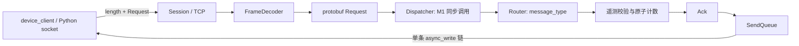

# 架构与阅读指南（M1 + M2.1）

本仓库是学习和面试演示用的独立重建版本。当前实现 TCP 最小链路及可暂停接收的状态基础；WebSocket、gRPC、业务工作线程和性能实验见 ROADMAP。没有持久化，也没有重试或去重。

## 模块与消息流

- `FrameDecoder` 只理解长度和字节，不依赖 socket 或 protobuf。每次 feed 最多产出一帧，返回本次消费量和 NeedMore/FrameReady/Error；完整帧保留到 take_body。
- `BufferedInput` 是 Session 持有的输入状态，保存固定 4 KiB 读缓冲、未消费区间和解码器。process 先尝试交付完整帧，再解析原始尾部；消费者返回 Paused 时保持状态，下次 process 从原位置继续。
- `Session` 负责 TCP 生命周期、protobuf 编解码和 ACK 排队。收到一帧才进入业务；解析失败关闭连接，不传递部分 Request。`read`/`write` 只启动异步操作，完成结果分别交给 `handle_read`/`handle_write`，避免把处理逻辑藏在多层 lambda 中。
- `Router::route` 通过 switch 找到已实现的 TELEMETRY 处理分支，校验公共字段、更新统计，返回普通 protobuf Ack。只存在一个处理器时无需动态注册框架。
- `Dispatcher::dispatch` 是 M1 的同步执行边界，没有投递和等待。任务等待容量为 **0**；没有线程池或异步业务队列。M2 再实现有界工作队列和跨线程 completion，避免本轮引入未使用的抽象。
- `Config` 校验字段类型、范围和未知键，启动时失败优于带错配置运行。`Server` 管理监听、最大连接数和信号退出。

业务核心只依赖生成的 Request/Ack 和统计对象，不依赖 Asio socket、Beast 或 gRPC 类型。当前业务是受帧长限制的校验和计数，适合内联；加入数据库、文件或耗时计算前必须先完成 M2。

## 线程与串行性

一个 `io_context` 由 `io_threads` 个 Linux 线程运行，主线程也调用 `run()`。线程不是每连接固定绑定的；strand 保证同一连接的回调不会并发执行，而不是保证运行于同一个 OS 线程。

- Server 的 acceptor、signal_set、连接表只在管理 strand 使用。
- 每个新 socket 在创建时就使用独立 strand 作为 executor。start/stop 用 `dispatch(socket.get_executor(), ...)` 进入它；读写完成回调使用 socket 的 executor，因此连接成员无须加锁。
- 每个连接只有一个 `async_read_some` 链。read_in_progress_ 防止重复启动和在途缓冲被解析；只有 BufferedInput 返回 NeedRead，且连接没有暂停，才启动下一次读。
- 第一次入发送队列才启动 `async_write`；后续写只由前一次写完成回调启动。读写可以同时进行，多次写不能重叠。
- 多连接会同时更新 Statistics，用 relaxed 原子自增。计数不用于发布其他共享状态；退出时所有线程 join 后输出最终统计。

M1 没有业务线程，因此没有跨线程业务结果。M2 的 completion 必须 `post` 回原连接 strand，不能从工作线程修改发送队列。

## 容量与失败策略

| 资源 | M1 限制与处理 |
| --- | --- |
| 网络读缓冲 | 每连接固定 4096 字节，最多一条读链 |
| 帧消息体 | 长度必须 >0 且不超过 max_body_bytes（默认 1 MiB） |
| 接收解析器 | 一份不完整或待接管的完整消息体；声明超过 max_receive_body_bytes 就在 reserve/append 前关闭 |
| 发送队列 | 同时检查 max_send_messages 和 max_send_bytes；含包头、含当前在途写；超限关闭 |
| 连接 | max_connections；超限的新连接立即关闭 |
| 业务等待任务 | 0，内联执行，无后台排队 |

这些是应用数据内容的容量限制，不是 RSS 配额。`std::string` capacity、protobuf 解析对象、共享指针、队列节点、日志和内核 socket 缓冲还有开销；string 可能保留此前容量或按实现扩大分配。应用内存规模受连接数、接收容量和发送容量约束，但 M1 没有按消息/字节统一计费的全局预算。配置上限是保护措施，不代表把所有配置调到最大后仍适合本机内存。

`feed` 校验完整包头后才调用 `reserve`，不会根据 0xffffffff 这样的未校验值分配。单测记录拒绝前后的 string capacity，检查容量没有增长，且消费者没有被调用。

发送预算拒绝发生在业务完成后，因此业务计数可能已经增加，而设备收不到 ACK。M1 在超限时关闭，不实施高低水位暂停/恢复；慢读者可能断连。消息数量限制通过队列单测确定性覆盖；socket 测试将 max_send_bytes 设为 1，验证单 ACK 超限的真实关闭路径，不依赖内核缓冲何时填满。

## 生命周期与退出

异步读回调捕获 `shared_ptr<Session>`，Session 内 BufferedInput 的固定读缓冲因此存活到操作完成。每次写回调还捕获 `shared_ptr<const string>`：即使 close 清空发送队列，在途写的 buffer 仍然有效。这是取消操作中最容易遗漏的所有权。

`Session::close` 在连接 strand 内检查 closed 标志，执行 cancel/shutdown/close、清空排队数据，然后向 Server strand post 删除连接表项。重复 close 和取消完成回调均安全返回；关闭不会把后续帧继续交给业务。回调只弱引用 Server，避免连接表形成循环所有权；main 保留 Server 直到所有 I/O 完成，Dispatcher 引用始终有效。

SIGINT/SIGTERM 在管理 strand 中关闭监听和取消 signal_set，再把各连接的关闭投递到对应 strand。没有新增工作后，取消回调、连接删除回调全部执行，`io_context::run()` 自然返回，线程 join，输出统计和 stopped。正常路径不通过 `io.stop()` 跳过清理。

M1 的退出是有序取消，不排空 ACK；不承诺所有已收到的消息都完成。也未创建心跳或超时定时器，因此本阶段没有连接级定时器需要取消。M2 再加入定时器取消和业务 drain 的退出期限。

## M2.1 的暂停与恢复

FrameDecoder 的 feed 不再调用业务。NeedMore 表示输入已消费且消息未收齐；FrameReady 返回当前帧边界的消费量，并保留 body；Error 是终止状态。FrameReady 时重复 feed 返回消费量 0，直到 take_body 转移数据并重置进度，不能用零消费量反复循环。

BufferedInput::process 将完整帧借给消费者。Accepted 表示消费者已经处理完或拥有自己的数据副本，随后释放当前帧；Paused 保留消息体和输入偏移；Stopped 不再交付后续帧。消息体引用不能保存在异步任务中跨回调使用。

例如一次读到 A/B/C，在 B 处暂停时，A 已处理，B 保存在解码器中，C 留在原始缓冲；恢复后重试 B，成功后处理 C。整个过程不需要重新接收，也不覆盖旧缓冲。

Session::pause_reading 和 resume_reading 都进入连接 strand。暂停不取消已经启动的读；在途读完成后先 commit_read 保存返回数据，再等待恢复。resume_reading 进入统一 process_buffered_input 路径，已有帧和尾部未处理完时不会读新数据。close 只终止输入处理，不能提前销毁在途读所引用的存储。

当前同步业务路径不主动触发暂停。确定性 gate 单测覆盖同一 BufferedInput 处理路径；完整业务队列与高低水位将在 M2.2/M2.3 接入。M2.1 没有新增工作线程、预算或定时器。

## 优先阅读三个函数

1. `FrameDecoder::feed`（src/frame.cpp）：按本次输入返回消费量，收齐一帧立即停下。
2. `BufferedInput::process`（src/buffered_input.cpp）：完整帧接管、暂停保留、输入偏移与恢复顺序。
3. `Session::process_buffered_input`（src/server.cpp）：连接 strand 内推进输入，只有 NeedRead 才允许启动新读。

然后阅读 `FrameDecoder::take_body` 理解存储所有权交接，阅读 `Session::handle_body` 和 `Session::write` 理解业务完成边界与发送 buffer 生命周期。
