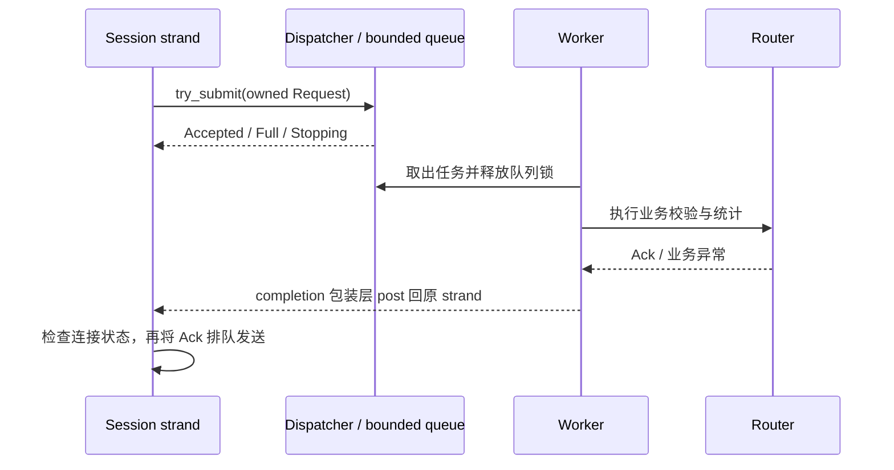

# M2 实施计划

状态：M2.1 已完成，M2.2–M2.5 为规划。M2.1 交付见 [变更范围](changes-m2.1.md) 和 [验证记录](validation-m2.1.md)。M1 的实测记录见 [validation-m1.md](validation-m1.md)；本文件不代表新增功能已通过验证。

M2 的目标是让 TCP 网关在慢业务、慢读者和资源紧张时保持有界，并能解释每一份数据、任务和异步回调由谁持有。继续使用 C++20、Linux apt 工具链和当前 AGENTS.md；不提前实现 WS/gRPC 或压测。

## M1 起点与 M2 所需变化

| 当前位置 | M1 行为 | M2 要解决的问题 |
| --- | --- | --- |
| Dispatcher::dispatch | 连接 strand 内同步调用 Router | 独立业务线程、有界投递、执行结果异步返回 |
| FrameDecoder::feed | bool 回调，只区分继续/停止 | 暂停与错误分开，保留未消费输入，恢复不丢帧 |
| Session::handle_read | 处理当前输入后启动下一次读 | 保存读偏移，按预算、水位和限流决定是否继续读 |
| Session::handle_body | 立即获得 Ack，直接入发送队列 | 异步任务生命周期、结果回送、关闭后的迟到结果 |
| SendQueue | 超限断连，当前写计入队列 | 高低水位恢复、输出预留、全局计费和取消后归还 |
| Server::stop | 停监听、取消所有连接 | 停止准入、排空已接收任务及 ACK、超时取消和 join |

现有业务校验规则、request_id 关联、TCP 长度头和 protobuf 消息主体继续复用。已有错误值保持兼容；只在需要表达业务内部失败或心跳时新增 protobuf 枚举，并补充协议文档。

## 五个可独立验收的步骤

| 步骤 | 主要交付 | 完成条件 |
| --- | --- | --- |
| M2.1 解析暂停与恢复（已完成） | 消费位置、可区分的解析状态、保留尾部数据 | 任意暂停点恢复后不丢帧、不重复，先处理已有数据 |
| M2.2 有界业务执行 | 显式任务队列、固定业务线程、异步 Dispatcher | 数量/字节边界、线程隔离、满队列、异常和断连回送测试通过 |
| M2.3 完整背压 | 本地/全局预算、读预留、高低水位、受控唤醒 | 慢业务/慢读者下所有预算守恒，恢复可推进 |
| M2.4 限流与超时 | 令牌桶、应用心跳、空闲/半包/写入及资源等待超时 | 可控制时间的边界测试，取消后旧定时器不再关闭连接 |
| M2.5 优雅退出 | drain 状态机、截止时间、取消与线程回收 | 活动读写/任务下 SIGINT/SIGTERM 可验证，预算最终归零 |

每轮只推进一个步骤，更新架构、协议和验证记录，单独提交。只有全部完成才标记 M2 完成。M2.2 的暂时策略是容量不足拒绝投递并关闭连接；M2.3 再替换为可恢复背压，不能提前声称已实现完整流控。

## M2.1：解码接口与输入恢复（已完成）

本步解决旧版 feed 的 bool 无法区分错误与暂停、也不返回消费量的问题。Session 内新增 BufferedInput 保存原始输入偏移和待处理帧，为异步业务一次接管一个请求做准备。以下为本步设计与验收要求，实际结果见验证记录。

解析与业务回调已分开，feed 返回带 consumed_bytes 的 DecodeResult，每次最多产出一帧，状态仅保留三种：

| 状态 | 含义 | Session 动作 |
| --- | --- | --- |
| NeedMore | 输入已消费，包头或消息体还未收齐 | 有读信用时等待更多字节 |
| FrameReady | 已持有一个完整消息体 | 下游允许时取走，否则保留并暂停 |
| Error | 长度或解析状态非法 | 记录错误并关闭 |

FrameReady 状态下，在 take_body 取走消息体之前，不解析下一帧；再次 feed 返回消费量 0 和同一状态。take_body 转移消息体所有权并重置当前帧进度。Session 必须在 FrameReady 时明确处理或暂停，不能对消费量 0 反复循环。

暂停是 Session 的调度决定，不再混入解析器的错误返回。Session 在成员读缓冲中保存未消费区间的起止偏移；缓冲尚有数据时，不启动覆盖它的新读。恢复顺序固定为：尝试处理已完成待投递帧 → 消费已有原始字节 → 资源仍允许时发起下一次读。

本步仍按 M1 同步执行 Router，先不引入 worker。测试用可控制的消费者暂时拒绝接管，验证生产代码中的恢复入口。下一步 M2.2 直接复用这个入口，在已有业务任务时暂停、完成回送后恢复。

首批验收：

- 包头和消息体的每个切点、空输入、精确边界与超长头，原有 M1 行为保持。
- A/B/C 连续帧在 B 处暂停：未消费字节数准确，恢复后 B、C 各处理一次。
- FrameReady 重复查询不清空消息体；取走后新帧能正确开始。
- 保留完整帧或尾部半包时关闭连接，缓冲和所有权正确释放。
- 恢复处理完已有输入之前，不启动第二条读链或覆盖原读缓冲。

修改范围为 frame.hpp/.cpp、新增 BufferedInput、Session 的输入处理、CMake 源文件登记，以及对应测试和文档。保留原验收覆盖，更新受接口变化影响的单测调用。

## M2.2：有界业务执行

新增简单的 BoundedTaskQueue：内部持有任务容器、mutex 和 condition_variable。工作线程可等待任务，I/O 线程只调用非等待式 try_submit；队列容量不足立即返回，不能等待空位。不得把业务任务直接 post 到一个无界线程池。

任务队列同时限制排队数量和请求字节数；执行中任务由固定线程数限制。另设 outstanding 预算覆盖排队、执行中和等待回送的任务，防止工作线程完成很快时，把无界积压转移到 io_context 的结果回调中。数量和字节都必须检查，执行线程数不能作为字节预算的替代。

Dispatcher 拟提供 try_submit，结果明确区分 Accepted、Full、Stopping。只有 Accepted 才接管请求所有权。Request 在队列中拥有自己的数据，不能保存来自解析器 body_ 的引用。完成结果由值或拥有所有权的对象传递，Router 仍不包含 Asio、socket 或其他传输类型。

先采用每连接最多一个正在执行或等待业务完成回送的请求；不同连接可并行业务处理。一次业务完成回送后才允许该连接提交下一项，M2 内保持同连接业务顺序，不增加结果重排缓存。已生成且尚未写完的 ACK 仍由发送预算单独限制。

线程关系如下：

回送包装层由 Transport 提供，捕获弱连接引用和回送 executor；业务核心不直接操作 Session。Worker 不持队列锁执行业务或触发 completion，不接触发送队列。业务异常在工作线程边界转换为有界的失败结果，不允许异常直接退出 worker。

任务拥有预算凭证，凭证跨越 queue、worker 和结果回调；直到结果在连接 strand 消费或被丢弃才归还 outstanding 预算。连接提前关闭不等于后台任务已经结束，不能提前释放仍被任务占用的数据预算。

M2.2 首批测试：

- 用可手动放行的处理器阻塞 worker，确定性填满数量与字节容量；try_submit 不等待。
- 验证业务执行线程与提交线程不同；多连接可并行，同连接业务顺序不变。
- 验证业务完成前没有 ACK，完成后 request_id 正确；内部失败结果仍可关联请求。
- 关闭连接后再放行业务，迟到结果被丢弃，无悬挂引用、重复关闭或预算泄漏。
- Worker 完成但 I/O 尚未消费回调时，outstanding 仍占用预算。
- 保留全部 M1 回归；测试用 gate/barrier 控制时序，不靠 sleep 猜测队列状态。

本步会触及 business.hpp/.cpp、server.cpp、config.hpp/.cpp 和测试；新增任务队列及其测试文件。拆分 Session 文件仅在确有阅读需要时进行，不创建通用框架。

## M2.3：预算与完整背压

先定义计费单位，再写恢复逻辑。应用预算控制逻辑数据和拥有所有权的对象，不把它描述为精确 RSS；protobuf、容器和分配器开销仍需明确说明。

| 资源 | 数量计费 | 字节计费/所有权结束点 |
| --- | --- | --- |
| 原始读缓冲 | 每连接最多一个固定读块 | 接入时预留整个读块；在途操作完成且不再持有后释放 |
| 解析中的帧 | 每连接最多一个帧槽 | 校验长度后、分配前预留完整消息体；拒绝不分配 |
| 待投递/排队/执行任务 | 明确排队计数及 outstanding 计数 | 请求按文档定义的序列化字节计费，计到结果被消费/丢弃 |
| 完成结果及发送帧 | 包括尚未回到 strand 的结果和当前写 | 投递前预留有上界的 ACK 空间，写完成或取消回调释放 |

原始字节和解析后的 Request 若同时存在，分别占用各自预算；不能仅因为阶段切换就把仍存活的输入内存扣掉。预算凭证采用可移动、不可复制的 RAII 所有权，引用同一缓冲的 shared_ptr 不重复计费。清空发送队列时，在途 buffer 的凭证仍由写回调持有，取消请求发出时不能提前归还。

M2.3 需在合法包头完成、消息体 reserve 之前加入可暂停的准入点：由 Session 取得帧预算后才授权分配和继续组装。资源不足时停在包头完成状态并保存已有原始字节；不能等到 FrameReady 才申请接收预算。该准入状态在本步扩展，不让 M2.1 提前依赖预算模块。

本地容量和全局容量同时准入。申请多个必要凭证时采用全部成功或全部回滚，不让任务拿着一部分预算永久等待另一部分。避免执行完成后才发现没有任何地方容纳 ACK；ACK 错误信息必须有长度上限，预留上界与配置启动校验一起定义。

高低水位同时检查数量和字节：任一指标达到高水位暂停，相关指标均降至低水位且所需预算可获取才恢复。硬上限负责最后保护，低水位必须小于高水位，高水位不超过硬上限。

水位观察可排空的积压，不能把当前半帧的完整预留误当作可排空队列并导致它永远无法收齐。已准入帧要保留完成所需信用；完整待投递帧、业务和发送积压触发暂停新读取。全局空间不足时阻止新帧准入，已获得完整帧预算的读取必须能继续推进。实现前需用状态表验证此例外不会绕过硬容量。

固定读块在接入时已全额预留，因此一条已发起的 read 即使在暂停标志设置后完成，返回的数据仍有空间存放。暂停不等于 read 已被取消；处理完成回调后再决定是否继续读。

业务、发送和全局资源释放都可能触发恢复。等待登记数量受连接数限制，每连接最多一个待处理唤醒；回调在锁外触发并 post 到 strand。采用可检查的轮转顺序，避免广播唤醒产生新的无界任务队列。

验收：精确边界、高低水位回滞、预算申请失败回滚、慢读/慢业务、暂停后的在途 read、先处理已有数据、全局竞争及公平推进。每种成功、异常、取消和断连路径都检查计数与字节最终归还一次。

## M2.4：限流、心跳与超时

- 先做每连接按请求数和请求字节数的令牌桶；全局额度继续由预算约束。额度不足暂缓新准入，设有界等待期限，禁止靠 busy loop 重试。使用 steady_clock，测试可控制时间。
- 明确新增 HEARTBEAT 消息及其字段校验规则，响应仍携带 request_id；与设备客户端、协议文档一起更新。心跳消耗预算和限流额度，不能成为绕过资源限制的通道。
- 空闲时间以收到完整合法请求为准，不能通过零散垃圾字节无限续命。半帧从该帧第一个字节起计时，不因每个新字节重置。
- 服务端主动因背压暂停的时间不计入对端的半包进度期限；另设资源等待期限，防止无限占用连接。计时规则需要单测覆盖，不能把本地过载误报为对端故障。
- 增加写入期限，释放长期不读 ACK 的连接；写入期限在关闭时与其他定时器一起取消。
- 所有连接定时器在 strand 内启动/重置/取消，检查 operation_aborted 和有效代次，防止旧回调关闭已经恢复的连接。

超时默认值届时作为可配置策略记录；本计划不凭空指定性能目标或声称某个时限适合所有设备。

## M2.5：优雅退出与取消边界

拟采用 Running → Draining → Closing → Stopped。第一次信号停止监听和新任务准入；完成准入边界之后，尚未 Accepted 的请求不再承诺 ACK。已经 Accepted 的任务继续执行，并尽力排空对应 ACK。截止时间到达或再次收到停止信号时进入 Closing，取消连接、等待任务和可协作取消的执行任务。

IO 线程不等待 worker、不执行阻塞 join。维持必要的 io_context work guard，直到任务完成/丢弃回送和 socket 取消回调全部处理；然后退出 run，在主线程统一 join worker 和 I/O 线程，最后检查预算及输出统计。

C++ 不能安全强杀正在执行的线程。M2 的业务必须是有限时处理或支持协作取消；对于任意不可中断的阻塞调用，不能承诺仅靠网关的 drain 截止时间就完成进程退出。测试中的慢处理器必须响应停止信号，不使用 detach 隐藏问题。

验收包含：正常 drain 收到 ACK；到期取消无 ACK 保证；半包、慢写、排队任务、执行任务和迟到回送并存；重复信号；退出预算归零；Dispatcher 及预算状态活到最后一个回调完成。持久化、自动重试和 exactly-once 仍不实现。

## 提交与最终验证

建议按以下主题提交，每次附实际命令、结果、限制和三个重点函数：

1. refactor(m2): preserve decoder state and unread bytes across pauses
2. feat(m2): add bounded worker dispatch and strand completions
3. feat(m2): enforce local and global backpressure budgets
4. feat(m2): add rate limits, heartbeat and connection deadlines
5. feat(m2): drain accepted work and ACKs during shutdown

各步保持当前 M1 测试通过；新增确定性单测和真实 socket 用例，完成 Debug、Release、ASan/UBSan 验证。加入并发后单独运行 TSan；若 WSL 或系统库限制导致无法执行，保留原始错误并记录剩余验证，不把不可执行当作通过。TSan 与 ASan 分开构建。

业务 gate、受控完成顺序和测试时钟仅作为测试设施，不添加生产配置中的 sleep 或人为延迟。只增加验收所需计数，不提前实现 M4 的指标系统和压测报告。
